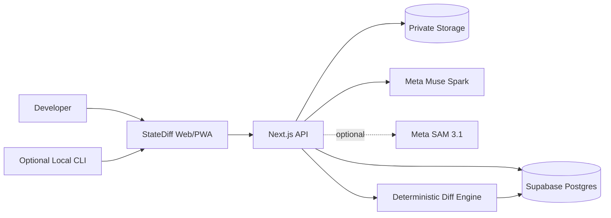
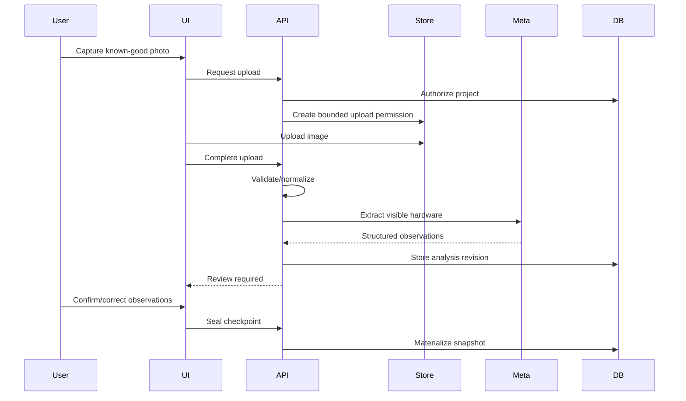

# StateDiff — System Architecture

**File:** `architecture.md`  
**Version:** 1.0  
**Status:** MVP implementation specification  
**Project:** StateDiff — Git for the physical world  
**Target:** Meta Global AI Developer Hackathon, Indie track, October–November 2026

## 1. Purpose

StateDiff correlates software revisions and test outcomes with photographed physical hardware states. Its primary output is an evidence-backed comparison between two checkpoints of an electronics workbench.

A checkpoint may include:
- One or more photographs of an ESP32/Arduino/breadboard setup.
- A Git commit SHA, branch and optional dirty-tree flag.
- A test result, timestamp and sanitized output.
- A human-reviewed representation of visible components and wire connections.
- The version of the AI extraction that produced the observations.

The system must distinguish **what the camera sees**, **what a user confirms**, **what a test observed**, and **what cannot be known**.

**Non-goals for MVP:** electrical simulation, verified continuity from photos, automated multimeter readings, full schematic reconstruction, continuous video tracking, autonomous hardware modification and production-grade team collaboration.

## 2. Architectural principles

1. **Evidence first.** Every material observation links to an image, test or Git record.
2. **Deterministic truth.** Application code computes differences; models propose observations and explanations.
3. **Human correction is a feature.** Users can correct pin endpoints and component identity before comparing states.
4. **Checkpoint-based.** Capture known-good and changed states; do not build an always-on vision system.
5. **Modular monolith first.** A Next.js application plus Supabase is sufficient for the hackathon.
6. **Private by default.** Images and project records are tenant-scoped.
7. **Graceful degradation.** Manual annotations and deterministic comparisons work if Meta inference fails.
8. **Reproducible demos.** Keep versioned fixtures and a clearly labelled replay mode.

## 3. Technology choices

| Concern | MVP selection | Reason |
|---|---|---|
| Frontend | Next.js App Router + React + TypeScript | Single web/backend codebase |
| UI | Tailwind CSS + shadcn/ui | Rapid accessible component assembly |
| Capture | Browser camera/file input | No native app required |
| Database | Supabase PostgreSQL | Relations, transactions, RLS |
| Authentication | Supabase Auth | User isolation without custom auth |
| Image storage | Supabase private Storage bucket | Controlled access to captures |
| Hosting | Vercel | Fast deployment and preview environments |
| Vision interpretation | Meta Model API, Muse Spark 1.3 | Structured multimodal observations |
| Segmentation | Meta SAM 3.1, optional | Masks/boxes, not electrical reasoning |
| Validation | Zod | Runtime schema validation |
| Unit tests | Vitest | Fast deterministic tests |
| E2E | Playwright | Capture/review/compare flows |
| Local integration | Optional Node.js CLI | Attach local Git SHA and test results |

Meta API model IDs and request envelopes must be verified by a live smoke test before hardcoding. Start with `muse-spark-1.3`; confirm the SAM identifier against the live model list and docs.

## 4. System context

**Trust boundaries**
- Browser input is untrusted, including image files and correction payloads.
- CLI data is authenticated but not intrinsically true; record its origin.
- Model responses are untrusted suggestions until validated.
- PostgreSQL constraints and RLS enforce tenant boundaries.
- The server holds all provider secrets.

## 5. Logical components

### 5.1 Capture UI
Responsibilities: request camera permission, show alignment guidance, allow retakes, preview images, display upload status and prevent accidental duplicate submissions.

Input: user-selected image.  
Output: a `capture` record plus private storage object.

### 5.2 Checkpoint service
Creates draft checkpoints, attaches captures and Git/test metadata, manages review state and seals immutable checkpoint revisions.

States:
`DRAFT → CAPTURED → ANALYZING → NEEDS_REVIEW → SEALED`

Failures may move `ANALYZING → ANALYSIS_FAILED`; the user can retry or continue with manual observations.

A sealed checkpoint must not be edited in place. Corrections produce a new snapshot version or an explicit amendment record.

### 5.3 Image pipeline
Server-side responsibilities:
- Verify authenticated ownership and content length.
- Check actual file signature, not only MIME.
- Decode and reject invalid images.
- Normalize orientation.
- Remove EXIF/geolocation metadata.
- Create bounded-resolution inference and preview variants.
- Store originals only when needed; document retention.
- Preserve the capture's original SHA-256 digest for provenance.

Do not transform or compress a file in the browser and then claim its digest represents the untouched original.

### 5.4 Vision adapter
The provider adapter receives a normalized image and extraction instructions, then returns a schema-validated `VisionObservationSet`.

It does not write authoritative graph edges directly. Store raw, bounded provider metadata and validated observations in a versioned analysis run.

Muse responsibilities:
- Identify visible boards, chips, resistors, sensors, wires and labels.
- Propose approximate image-space positions.
- Propose visible wire endpoint candidates.
- Mark obscured or ambiguous endpoints as unknown.
- Return evidence references and confidence estimates.

SAM responsibilities, if enabled:
- Produce segmentation masks or boxes for selected objects.
- Help draw overlays and isolate objects.
- Never infer electrical connectivity from masks alone.

### 5.5 Review and correction service
Presents each observation over the photograph. Users may accept, reject, relabel, merge, split or mark endpoints unknown.

Every correction records actor, timestamp, previous value, replacement value and affected observation ID.

### 5.6 Snapshot materializer
Builds a normalized, versioned graph from reviewed observations:
- Nodes: board, component and terminal.
- Parent-child relations: terminal belongs to a component or board.
- Edges: visually observed or user-confirmed wire connections.
- Unknown endpoints remain unresolved observations, not fabricated graph edges.

The materializer is deterministic and idempotent for a fixed correction revision.

### 5.7 Graph matching and diff engine
Given two sealed snapshots:
1. Match user-confirmed stable logical IDs.
2. Match remaining entities by kind, label and approximate geometry.
3. Mark ambiguous matches for review.
4. Compare terminal-to-terminal edges only when both endpoints are resolved.
5. Emit added, removed, moved, changed, unchanged and unresolved events.
6. Store the algorithm version and source snapshot versions.

Avoid treating color alone as wire identity. A wire moved between holes may look similar while representing a different connection.

### 5.8 Investigation service
Combines:
- Physical diff events.
- Test result transition, such as PASS → FAIL.
- Git revision differences.
- Evidence provenance and uncertainty.

It produces ranked **suspects**, not confirmed root causes. For example: “The jumper endpoint appears to have moved from the previously reviewed location; this coincides with the failing test.”

Scoring must be deterministic and explainable. AI can rewrite the explanation for clarity but cannot invent evidence.

### 5.9 Local CLI (P1)
Reads the local repository SHA and a test-result file or an explicitly chosen test command. The CLI must not execute model-generated commands.

Authentication: scoped project token or user device authorization, stored in OS-protected credential storage where possible.

## 6. Main workflows

### 6.1 Create baseline

### 6.2 Investigate regression

1. User captures the changed rig.
2. The second checkpoint receives the failing test run and Git SHA.
3. AI proposes observations, and the user reviews ambiguous endpoints.
4. Server materializes snapshot B.
5. Diff engine compares snapshot A against B.
6. Investigation service ranks evidence-backed suspects.
7. UI shows before/after imagery, overlays, test transition and Git context.
8. User fixes hardware or code and creates a recovery checkpoint.

### 6.3 Failure and recovery
If inference times out, retain the image and offer retry or manual markup. If Git metadata is unavailable, show “Not linked.” If a test has not run, do not infer PASS/FAIL. If graph matching is ambiguous, surface an unresolved item instead of silently guessing.

## 7. Internal API contract

Use `/api` Next.js Route Handlers. All mutation routes require authentication, validation, ownership checks and bounded request sizes.

| Method | Route | Responsibility |
|---|---|---|
| POST | `/api/projects` | Create project |
| GET | `/api/projects/:id` | Project details |
| POST | `/api/projects/:id/checkpoints` | Draft checkpoint |
| POST | `/api/checkpoints/:id/captures/initiate` | Upload authorization |
| POST | `/api/captures/:id/complete` | Validate completed upload |
| POST | `/api/checkpoints/:id/analyze` | Begin bounded inference |
| GET | `/api/checkpoints/:id/analysis` | Review observations |
| POST | `/api/checkpoints/:id/corrections` | Append correction |
| POST | `/api/checkpoints/:id/seal` | Materialize snapshot |
| POST | `/api/comparisons` | Compare sealed checkpoints |
| GET | `/api/comparisons/:id` | Comparison and findings |
| POST | `/api/checkpoints/:id/test-runs` | Attach test evidence |
| POST | `/api/checkpoints/:id/git-revisions` | Attach Git metadata |

Responses follow a consistent shape: success includes `data` and `requestId`; errors include `error.code`, `error.message` and `requestId`. Never expose stack traces or provider secrets.

All mutating operations should accept an idempotency key when retries could duplicate records.

## 8. Data ownership and invariants

The database schema is defined in `database.md`.

Canonical ownership: `projects.owner_id`; all project-scoped rows carry `project_id`. Every API and storage access must verify project ownership, and database RLS must independently enforce it.

Invariants:
- Every capture belongs to exactly one checkpoint.
- Every checkpoint belongs to one project and one rig.
- Every snapshot belongs to a checkpoint and a version.
- Every graph edge references terminals from the same snapshot.
- Every comparison references two sealed snapshots of the same project.
- Every finding references stored diff events or observed test/Git evidence.
- Every analysis run records provider, model, prompt version and schema version.
- Corrections never erase the original model observation.

## 9. Inference execution and jobs

**P0:** A bounded server-side request performs extraction and persists status. If the hosting request limit is too short, split processing into an authenticated, explicitly invoked step; do not claim that a detached promise is a durable background worker.

**P1:** Use a real queue/worker with retries, leasing and dead-letter handling. `jobs` records are a status ledger, not a substitute for a running worker.

Suggested states: `QUEUED`, `RUNNING`, `SUCCEEDED`, `FAILED`, `CANCELLED`.

Each job records project, input digest, model version, attempts, timestamps and safe error code. Duplicate requests for the same checkpoint/analysis version must be idempotent.

## 10. Security and privacy boundaries

- Supabase Storage bucket is private.
- Server-side Meta API key never appears in browser bundles.
- Image upload permissions expire quickly.
- Images are normalized and EXIF stripped before provider transmission.
- Users must explicitly initiate inference on their uploaded images.
- Test logs are sanitized for credentials and personal paths.
- No raw image bytes or API keys in telemetry.
- Model output cannot trigger commands, database DDL or external URLs.

Full controls are specified in `security.md`.

## 11. Observability

Record structured events:
`capture.uploaded`, `analysis.started`, `analysis.completed`, `analysis.failed`, `review.corrected`, `checkpoint.sealed`, `comparison.created`, `test.attached`.

Metrics:
- Upload success rate and duration.
- Vision latency and failure rate.
- Invalid-schema rate.
- Human correction rate.
- Unresolved endpoint rate.
- Diff computation latency.
- Per-analysis estimated inference cost.
- E2E checkpoint completion rate.

Use a request ID across API calls and job records. Do not log full prompts containing private user images or sensitive data.

## 12. Performance targets

Hackathon targets, to validate rather than assume:
- Initial page interaction under approximately 3 seconds on a typical mobile connection.
- Local diff computation under 1 second for a small rig.
- Single-image extraction target under 30 seconds, with clear progress and timeout recovery.
- Image inference input bounded by configured resolution and size.
- No unbounded parallel model requests.

Optimize first for reliability of one physical demo rig, not arbitrary electronics.

## 13. Deployment

**Development:** local Next.js, local or isolated Supabase, test Meta credentials.  
**Preview:** Vercel preview deployment, separate non-production database if feasible, fake/demo image fixtures.  
**Production/demo:** Vercel, Supabase production project, private bucket, restricted Meta key, protected environment variables.

Deployment checklist:
- Environment validation at startup.
- Database migrations applied.
- RLS and storage policies tested.
- Provider smoke test successful.
- No service-role key in client output.
- Demo fixture recovery mode available.
- Monitoring of API failures and inference budget.

## 14. Architecture decisions

**ADR-001: Modular monolith over microservices.** Reduces operational overhead during a ten-day hackathon.

**ADR-002: Checkpoints over continuous video.** Makes captures comparable and feasible with current vision limitations.

**ADR-003: Deterministic graph diff over LLM-generated diff.** Improves repeatability, testability and auditability.

**ADR-004: Explicit unknowns.** A missing or obscured wire endpoint must not become an asserted connection.

**ADR-005: Human-reviewed snapshot versions.** Preserves evidence and permits correction without rewriting history.

**ADR-006: SAM optional.** Segmentation should enhance visualization, not block the core workflow.

**ADR-007: No autonomous command execution.** Git/test integration uses explicit local user-controlled commands only.

## 15. Scope and implementation order

**P0:** auth, project, rig, checkpoint, photo upload, Muse extraction, review, snapshots, deterministic diff, test status, comparison UI, demo recovery flow.

**P1:** SAM masks, CLI, multiple images per checkpoint, job worker, richer matching, export.

**P2:** team workspaces, GitHub OAuth, device telemetry, live capture, schematic reasoning, mobile native app.

Suggested order:
1. Validate real breadboard photo extraction.
2. Implement DB and private capture flow.
3. Add schema-validated extraction and review.
4. Materialize snapshots and diff.
5. Attach Git/test metadata.
6. Build investigation UI and recovery demo.
7. Harden security and run E2E tests.

## 16. Definition of done

- [ ] Baseline and changed checkpoints can be captured on a phone.
- [ ] Two images produce separate versioned observation sets.
- [ ] User can correct at least one wrong endpoint.
- [ ] Sealed snapshots preserve original evidence and corrections.
- [ ] Deterministic diff detects the chosen physical change.
- [ ] PASS → FAIL transition is displayed accurately.
- [ ] Suspect explanation cites evidence and uncertainty.
- [ ] Private data is inaccessible to another user.
- [ ] The end-to-end demo works without SAM.
- [ ] A provider failure does not destroy the checkpoint.

## 17. References

- Meta Model API: https://dev.meta.ai/docs/overview
- Meta image understanding: https://dev.meta.ai/docs/image-understanding
- Meta structured output: https://dev.meta.ai/docs/cookbook/structured-output
- Meta SAM: https://dev.meta.ai/docs/sam/overview
- Next.js App Router: https://nextjs.org/docs/app
- Supabase: https://supabase.com/docs
- Vercel: https://vercel.com/docs

**Companion documents:** `database.md`, `AI agents instruction.md`, `Design system.md`, `security.md`, `code_style.md`, `testing.md`.
