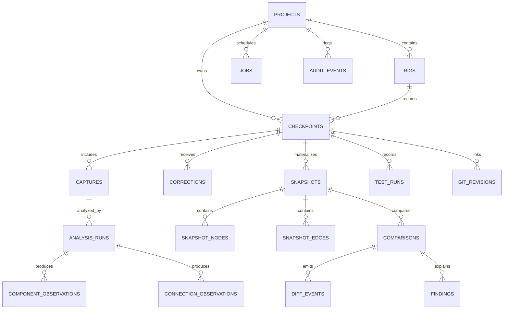

# StateDiff — Database Design

**File:** `database.md`  
**Version:** 1.0  
**Database:** PostgreSQL via Supabase  
**Status:** Implementation specification

## 1. Objectives

The database must support:
- Private user-owned electronics projects.
- Physical rigs and photographed checkpoints.
- Versioned AI observations and human corrections.
- Immutable, comparable graph snapshots.
- Git revisions and test results.
- Deterministic comparison events and investigation findings.
- Auditable processing and deletion.

Do not store the entire application as one mutable JSON document. Use relational records for identity, authorization and relationships, with JSONB for flexible model evidence and geometry.

## 2. Data conventions

- Primary keys: UUID, generated server-side.
- Timestamps: `timestamptz`, UTC.
- Names: snake_case tables and columns; plural table names.
- Every project-scoped table includes `project_id uuid not null`.
- Deletion: explicit cascade policy, not accidental implicit deletion.
- Flexible structured fields: JSONB with application-level Zod validation.
- Statuses: constrained text/check constraints or enums with versioned migrations.
- Never use floating-point confidence as a proof of physical correctness.
- Immutable evidence fields must not be overwritten after checkpoint sealing.

## 3. Entity relationship diagram



A comparison has both `baseline_snapshot_id` and `candidate_snapshot_id`; the diagram simplifies this dual relationship.

## 4. Canonical tables

### 4.1 `projects`

| Column | Type | Rules |
|---|---|---|
| id | uuid | PK |
| owner_id | uuid | NOT NULL, references `auth.users` |
| name | text | 1–120 chars |
| description | text | optional, bounded |
| default_rig_id | uuid | optional, added after rigs exist |
| created_at | timestamptz | NOT NULL |
| updated_at | timestamptz | NOT NULL |
| deleted_at | timestamptz | nullable soft-deletion marker |

MVP authorization: single owner. Team membership is P1, not silently assumed.

Indexes: `(owner_id, created_at desc)`, partial active-project index.

### 4.2 `rigs`

Represents a physical hardware setup, not a photo.

| Column | Type | Rules |
|---|---|---|
| id | uuid | PK |
| project_id | uuid | FK projects |
| name | text | required |
| board_family | text | e.g., ESP32, Arduino, unknown |
| description | text | optional |
| reference_notes | jsonb | optional known board/rail information |
| created_at | timestamptz | required |

A rig may have multiple checkpoints.

### 4.3 `checkpoints`

| Column | Type | Rules |
|---|---|---|
| id | uuid | PK |
| project_id | uuid | FK |
| rig_id | uuid | FK |
| label | text | required |
| status | text | draft/captured/analyzing/needs_review/sealed/analysis_failed |
| captured_at | timestamptz | nullable until capture |
| sealed_at | timestamptz | nullable until sealed |
| active_snapshot_id | uuid | nullable, references snapshots after creation |
| notes | text | bounded |
| created_by | uuid | authenticated user |
| created_at | timestamptz | required |

Enforce that the referenced rig belongs to the same project, using composite FKs or guarded database functions.

A sealed checkpoint is append-only with respect to evidence. A new correction requires a new snapshot revision.

### 4.4 `captures`

| Column | Type | Rules |
|---|---|---|
| id | uuid | PK |
| project_id | uuid | FK |
| checkpoint_id | uuid | FK |
| storage_path | text | unique within bucket |
| preview_path | text | optional |
| mime_type | text | validated |
| byte_size | bigint | positive, bounded |
| width_px | integer | positive |
| height_px | integer | positive |
| sha256 | text | 64-character hex digest |
| orientation_normalized | boolean | required |
| exif_stripped | boolean | required for inference variant |
| upload_status | text | pending/verified/rejected |
| created_at | timestamptz | required |

Storage path convention: `projects/{project_id}/checkpoints/{checkpoint_id}/captures/{capture_id}/image.webp`. Do not trust a client-provided path without server construction.

### 4.5 `analysis_runs`

| Column | Type | Rules |
|---|---|---|
| id | uuid | PK |
| project_id | uuid | FK |
| capture_id | uuid | FK |
| provider | text | meta |
| model_id | text | actual deployed model |
| prompt_version | text | required |
| schema_version | text | required |
| input_sha256 | text | required |
| status | text | queued/running/succeeded/failed |
| raw_response_metadata | jsonb | bounded, sanitized |
| error_code | text | nullable |
| started_at | timestamptz | nullable |
| completed_at | timestamptz | nullable |
| created_at | timestamptz | required |

Unique idempotency key may be derived from capture, model, prompt version and input digest. Do not assume that rerunning inference yields identical output.

### 4.6 `component_observations`

| Column | Type | Rules |
|---|---|---|
| id | uuid | PK |
| project_id | uuid | FK |
| analysis_run_id | uuid | FK |
| observation_key | text | unique within analysis run |
| kind | text | board/component/terminal/wire/unknown |
| label | text | nullable |
| parent_observation_key | text | nullable |
| bbox_normalized | jsonb | x/y/w/h in 0..1 |
| evidence | jsonb | image ID, region, rationale |
| confidence | numeric(4,3) | nullable, 0..1 |
| provenance | text | vision_inferred |
| review_status | text | pending/accepted/rejected/corrected |
| created_at | timestamptz | required |

These are model observations, not necessarily canonical graph nodes.

### 4.7 `connection_observations`

| Column | Type | Rules |
|---|---|---|
| id | uuid | PK |
| project_id | uuid | FK |
| analysis_run_id | uuid | FK |
| wire_observation_key | text | nullable |
| endpoint_a_candidate | jsonb | label, image position, certainty |
| endpoint_b_candidate | jsonb | same |
| color_label | text | optional |
| evidence | jsonb | image-region references |
| confidence | numeric(4,3) | nullable |
| review_status | text | pending/accepted/rejected/corrected |
| created_at | timestamptz | required |

Unknown endpoints remain nullable/unresolved. Do not force a guessed foreign key.

### 4.8 `corrections`

Append-only review log.

| Column | Type | Rules |
|---|---|---|
| id | uuid | PK |
| project_id | uuid | FK |
| checkpoint_id | uuid | FK |
| analysis_run_id | uuid | nullable FK |
| target_type | text | component/connection/snapshot |
| target_id | uuid | target reference |
| action | text | accept/reject/relabel/set_endpoint/merge/split/unknown |
| before_value | jsonb | nullable |
| after_value | jsonb | nullable |
| actor_id | uuid | authenticated user |
| created_at | timestamptz | required |

The application must validate that target and checkpoint belong to the same project.

### 4.9 `snapshots`

| Column | Type | Rules |
|---|---|---|
| id | uuid | PK |
| project_id | uuid | FK |
| checkpoint_id | uuid | FK |
| version | integer | starts at 1 |
| source_analysis_run_id | uuid | nullable |
| correction_revision | integer | required |
| materializer_version | text | required |
| sealed_by | uuid | user |
| created_at | timestamptz | required |

Unique `(checkpoint_id, version)`. Never update nodes or edges belonging to an already sealed snapshot.

### 4.10 `snapshot_nodes`

| Column | Type | Rules |
|---|---|---|
| id | uuid | PK |
| project_id | uuid | FK |
| snapshot_id | uuid | FK |
| logical_key | text | stable within snapshot |
| kind | text | board/component/terminal |
| label | text | optional |
| parent_node_id | uuid | nullable self-FK |
| geometry | jsonb | normalized image-space region |
| provenance | text | vision_inferred/user_confirmed |
| evidence_refs | jsonb | observation and capture IDs |
| confidence | numeric(4,3) | nullable |
| created_at | timestamptz | required |

Unique `(snapshot_id, logical_key)`. Stable logical keys across checkpoints are only assigned when identity matching is sufficiently supported or user-confirmed.

### 4.11 `snapshot_edges`

| Column | Type | Rules |
|---|---|---|
| id | uuid | PK |
| project_id | uuid | FK |
| snapshot_id | uuid | FK |
| from_terminal_node_id | uuid | FK snapshot_nodes |
| to_terminal_node_id | uuid | FK snapshot_nodes |
| wire_label | text | optional |
| wire_color | text | optional |
| provenance | text | vision_inferred/user_confirmed |
| evidence_refs | jsonb | required |
| confidence | numeric(4,3) | nullable |
| created_at | timestamptz | required |

Constraints:
- Both endpoints must be `kind = terminal`.
- Both endpoints must belong to the edge's snapshot.
- No self-edge unless explicitly supported.
- Canonicalize endpoint order to prevent duplicate undirected edges.
- Do not infer breadboard bus continuity unless a separate user-verified topology model exists.

Some cross-table constraints require triggers or database functions; ordinary CHECK constraints cannot query other rows.

### 4.12 `git_revisions`

| Column | Type | Rules |
|---|---|---|
| id | uuid | PK |
| project_id | uuid | FK |
| checkpoint_id | uuid | FK |
| commit_sha | text | validated hex, 40 or 64 chars |
| branch_name | text | optional, bounded |
| is_dirty | boolean | optional |
| source | text | manual/cli |
| recorded_at | timestamptz | required |

Do not store repository access tokens or entire source code.

### 4.13 `test_runs`

| Column | Type | Rules |
|---|---|---|
| id | uuid | PK |
| project_id | uuid | FK |
| checkpoint_id | uuid | FK |
| name | text | required |
| status | text | pass/fail/error/skipped/unknown |
| exit_code | integer | nullable |
| duration_ms | integer | nullable |
| output_excerpt | text | sanitized, bounded |
| source | text | manual/cli |
| recorded_at | timestamptz | required |

A test status is observed evidence only if a test actually ran. Manual status is labelled manual.

### 4.14 `comparisons`

| Column | Type | Rules |
|---|---|---|
| id | uuid | PK |
| project_id | uuid | FK |
| baseline_snapshot_id | uuid | FK |
| candidate_snapshot_id | uuid | FK |
| algorithm_version | text | required |
| status | text | pending/completed/failed |
| summary | jsonb | counts and metadata |
| created_by | uuid | authenticated user |
| created_at | timestamptz | required |

Both snapshots must belong to the same project and should represent the same rig. Enforce through server validation and database safeguards.

### 4.15 `diff_events`

| Column | Type | Rules |
|---|---|---|
| id | uuid | PK |
| project_id | uuid | FK |
| comparison_id | uuid | FK |
| event_type | text | added/removed/moved/connection_changed/unresolved |
| entity_kind | text | component/terminal/connection |
| baseline_ref | jsonb | nullable |
| candidate_ref | jsonb | nullable |
| evidence_refs | jsonb | required |
| severity | text | informational/suspect/unknown |
| created_at | timestamptz | required |

Diff events are computed, not directly written by an LLM.

### 4.16 `findings`

| Column | Type | Rules |
|---|---|---|
| id | uuid | PK |
| project_id | uuid | FK |
| comparison_id | uuid | FK |
| rank | integer | positive |
| title | text | required |
| explanation | text | bounded |
| score | numeric | bounded |
| uncertainty | text | required |
| evidence_refs | jsonb | required |
| explanation_model | text | nullable |
| created_at | timestamptz | required |

Unique `(comparison_id, rank)`.

### 4.17 `jobs` and `audit_events`

`jobs`: id, project_id, kind, target_id, idempotency_key, status, attempt_count, error_code, started_at, completed_at, created_at.

`audit_events`: id, project_id, actor_id, event_type, entity_type, entity_id, safe_metadata, request_id, created_at.

Audit logs should contain IDs and event names, not raw photos, secrets or unredacted test output.

## 5. SQL examples

Illustrative DDL; apply as versioned migrations and extend consistently.

```sql
create table public.projects (
  id uuid primary key default gen_random_uuid(),
  owner_id uuid not null references auth.users(id),
  name text not null check (char_length(name) between 1 and 120),
  description text,
  created_at timestamptz not null default now(),
  updated_at timestamptz not null default now(),
  deleted_at timestamptz
);

create index projects_owner_created_idx
  on public.projects (owner_id, created_at desc);

alter table public.projects enable row level security;

create policy "owners read projects"
  on public.projects for select to authenticated
  using (owner_id = (select auth.uid()));

create policy "owners insert projects"
  on public.projects for insert to authenticated
  with check (owner_id = (select auth.uid()));

create policy "owners update projects"
  on public.projects for update to authenticated
  using (owner_id = (select auth.uid()))
  with check (owner_id = (select auth.uid()));

create policy "owners delete projects"
  on public.projects for delete to authenticated
  using (owner_id = (select auth.uid()));
```

Project-scoped child policy pattern:

```sql
using (
  exists (
    select 1 from public.projects p
    where p.id = project_id
      and p.owner_id = (select auth.uid())
      and p.deleted_at is null
  )
)
```

Use this expression in appropriate SELECT/UPDATE/DELETE policies and a corresponding `WITH CHECK` for INSERT/UPDATE. Verify SQL grants separately; RLS does not replace grants.

## 6. Row Level Security strategy

**MVP:** project owner is the only authorized actor.

Every project-scoped table:
1. Enable RLS.
2. Define SELECT, INSERT, UPDATE and DELETE policies explicitly.
3. Limit permitted operations by record lifecycle where needed.
4. Check the owning project, not just a client-supplied user ID.
5. Reject cross-project foreign keys.
6. Test with two real authenticated users.

The service-role credential bypasses RLS and must never be exposed to the browser. Prefer user-scoped clients for normal CRUD. When server-admin operations are necessary, perform explicit ownership checks before using elevated privileges.

**P1:** `project_members(project_id, user_id, role)` with a carefully audited authorization helper. Do not add team access implicitly.

## 7. Storage schema and access

Bucket: `checkpoint-captures`, private.

Object metadata lives in `captures`. Use server-constructed paths and short-lived signed URLs or authenticated reads. Storage policies must ensure that the path's project ID corresponds to a project owned by the current user.

Never rely on a path prefix alone without verifying the associated project. Do not use public URLs for private hardware images.

For each upload:
- Generate capture UUID server-side.
- Issue bounded upload authorization.
- Validate completed object.
- Normalize and strip EXIF.
- Record digest and dimensions.
- Reject or delete invalid objects.

## 8. Indexing plan

Priority indexes:
- `rigs(project_id, created_at desc)`
- `checkpoints(project_id, rig_id, created_at desc)`
- `captures(checkpoint_id, created_at)`
- `analysis_runs(capture_id, created_at desc)`
- `component_observations(analysis_run_id)`
- `connection_observations(analysis_run_id)`
- `corrections(checkpoint_id, created_at)`
- `snapshots(checkpoint_id, version desc)` unique version constraint
- `snapshot_nodes(snapshot_id, logical_key)` unique
- `snapshot_edges(snapshot_id)`
- `test_runs(checkpoint_id, recorded_at desc)`
- `git_revisions(checkpoint_id, recorded_at desc)`
- `comparisons(project_id, created_at desc)`
- `diff_events(comparison_id)`
- `findings(comparison_id, rank)`
- `jobs(status, created_at)` for future workers
- `audit_events(project_id, created_at desc)`

Add GIN indexes for JSONB only after measuring a real query need.

## 9. Transactions and consistency

Checkpoint sealing should occur in a single transaction:
1. Verify checkpoint ownership and review readiness.
2. Lock the checkpoint row.
3. Determine next snapshot version.
4. Insert snapshot.
5. Insert reviewed nodes and resolved edges.
6. Validate same-snapshot references.
7. Set `active_snapshot_id`.
8. Update checkpoint state.
9. Commit.

Comparison creation should pin exact snapshot IDs and algorithm version. Later corrections must not silently change an existing comparison.

Use optimistic concurrency or expected revision numbers for correction writes to avoid lost updates.

## 10. Provenance

Canonical values:
- `VISION_INFERRED`
- `USER_CONFIRMED`
- `TEST_OBSERVED`
- `GIT_OBSERVED`
- `DEVICE_MEASURED`
- `UNKNOWN`

Not every provenance type applies to every table. For example, a model observation is `VISION_INFERRED`, while a local test run is `TEST_OBSERVED`.

Do not upgrade `VISION_INFERRED` to `DEVICE_MEASURED` merely because confidence is high.

## 11. Data retention and deletion

MVP policy should be published and configurable before public launch:
- Original image retention: retain until user deletion unless an explicit shorter policy is selected.
- Temporary upload objects: clean up abandoned uploads after a defined window.
- Provider response metadata: retain only safe bounded metadata.
- Audit events: bounded retention appropriate to the product.
- User project deletion: delete private storage objects, relational children and derived artifacts.
- Deletion workflow: mark pending, remove storage objects, delete DB records, record completion without keeping sensitive content.

Do not claim provider-side deletion unless Meta's actual policy and API support it.

## 12. Migrations

Use `supabase/migrations/YYYYMMDDHHMMSS_description.sql`.

Rules:
- Every schema change is committed.
- Never edit a migration already applied to shared environments.
- Prefer additive changes.
- Backfill before enforcing new NOT NULL constraints.
- Apply RLS and grants in the same migration as new tables.
- Test rollback strategy or compensating migration.
- Generate/update TypeScript DB types after migrations.

Suggested order:
1. Projects and rigs.
2. Checkpoints and captures.
3. Analysis observations and corrections.
4. Snapshots and graph.
5. Git/test evidence.
6. Comparisons and findings.
7. Jobs, audit and indexes.
8. RLS/storage hardening.

## 13. Useful queries

**Project timeline:** checkpoints for a rig ordered by capture time, with latest test status and Git SHA.

**Latest reviewed snapshot:** highest version for a checkpoint with materialization completed.

**Regression candidates:** comparisons where baseline's latest test is PASS and candidate's latest test is FAIL.

**Human review workload:** pending observations plus unresolved connection endpoints per checkpoint.

**Inference quality:** accepted/corrected/rejected observations grouped by model and prompt version.

Use bounded pagination for timelines and findings.

## 14. Test cases

- [ ] User A cannot select, insert, update or delete User B's project data.
- [ ] A capture cannot reference a checkpoint from another project.
- [ ] A snapshot edge cannot reference a terminal from another snapshot.
- [ ] A sealed snapshot cannot be modified.
- [ ] Two simultaneous seal requests cannot create duplicate version numbers.
- [ ] Correction history preserves original values.
- [ ] A comparison pins exact snapshot versions.
- [ ] An unresolved endpoint is not converted into a fabricated edge.
- [ ] Storage policy blocks cross-user image access.
- [ ] Deleting a project removes associated private objects.

## 15. MVP versus later

**P0:** single owner, all canonical tables required by capture/review/diff, RLS, private storage, migrations.

**P1:** membership, richer image metadata, queue leasing, materialized aggregate views.

**P2:** cross-project component libraries, temporal graph analytics, telemetry and electrical measurement records.

## 16. References

- Supabase PostgreSQL: https://supabase.com/docs/guides/database
- RLS: https://supabase.com/docs/guides/database/postgres/row-level-security
- Storage access control: https://supabase.com/docs/guides/storage/security/access-control
- Database migrations: https://supabase.com/docs/guides/deployment/database-migrations

**Companion documents:** `architecture.md`, `security.md`, `testing.md`.
